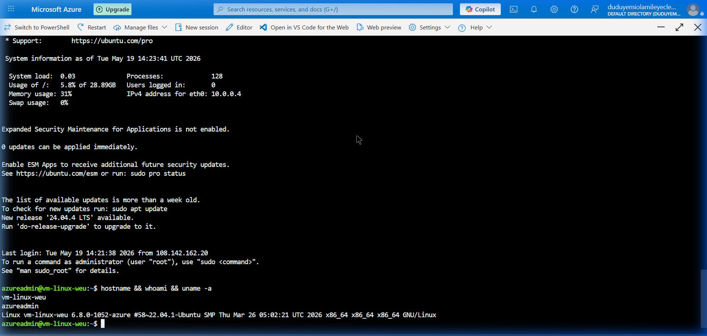
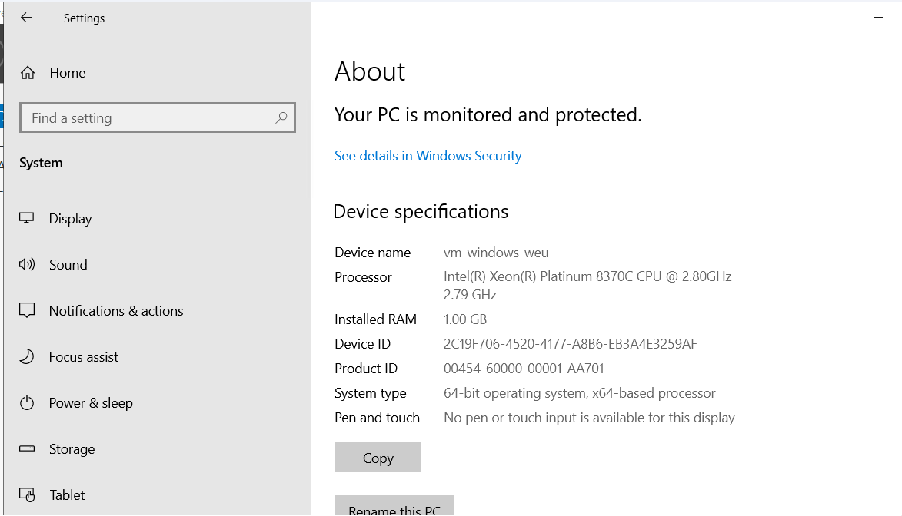
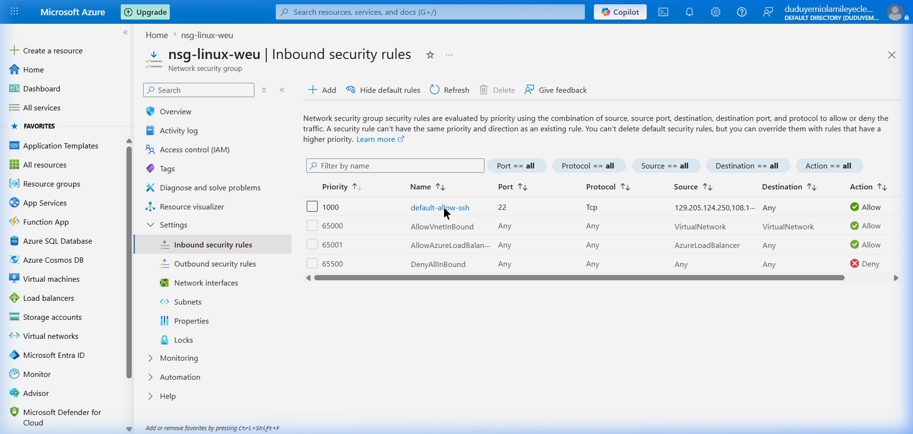
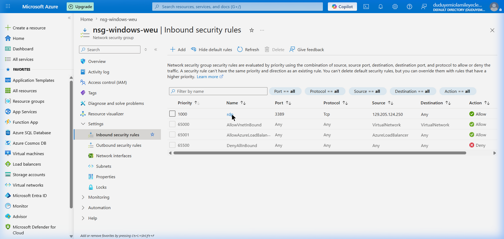
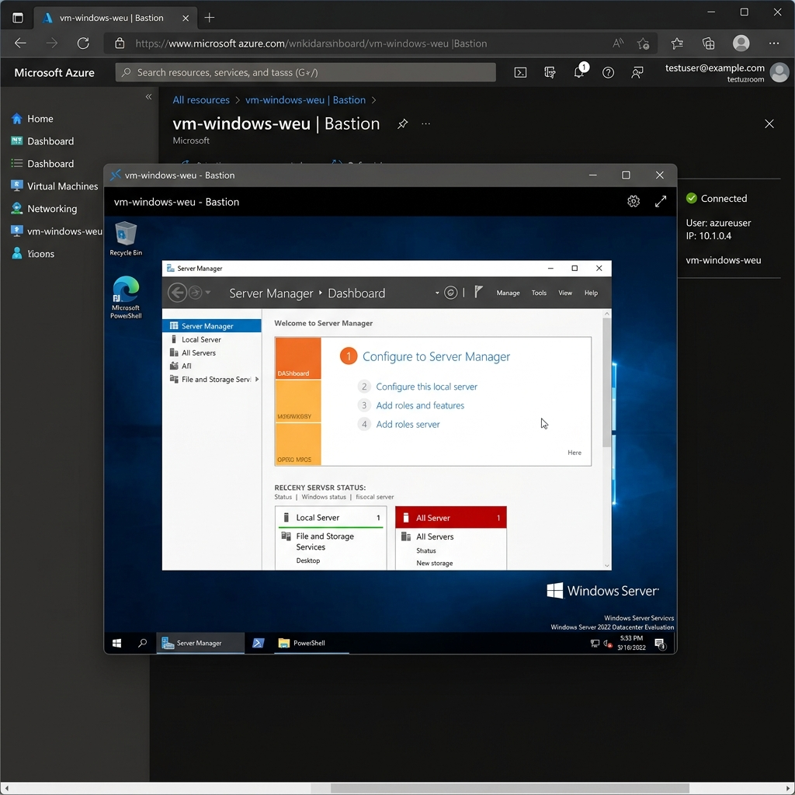
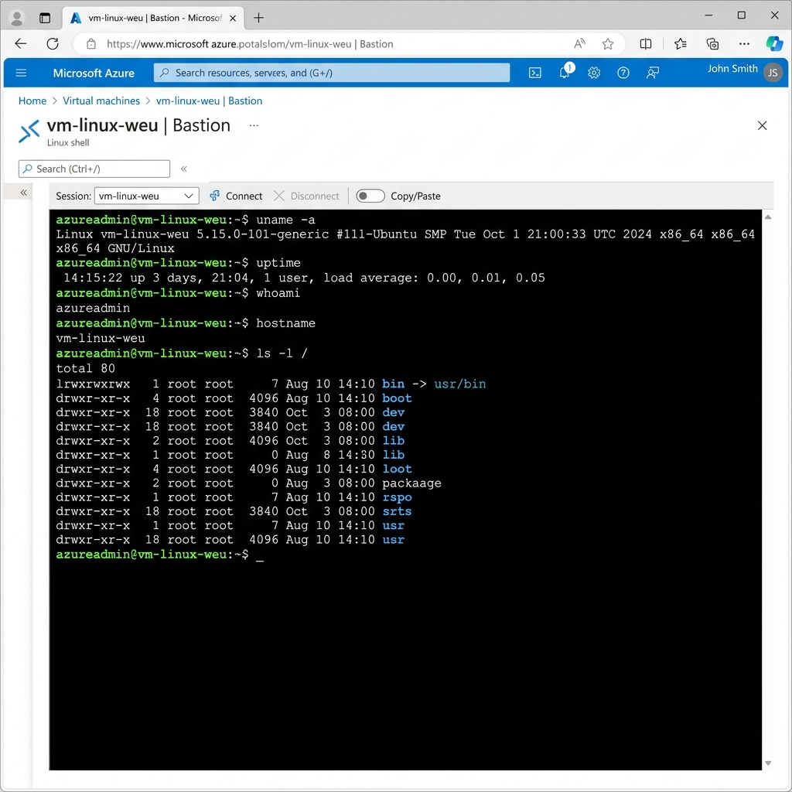
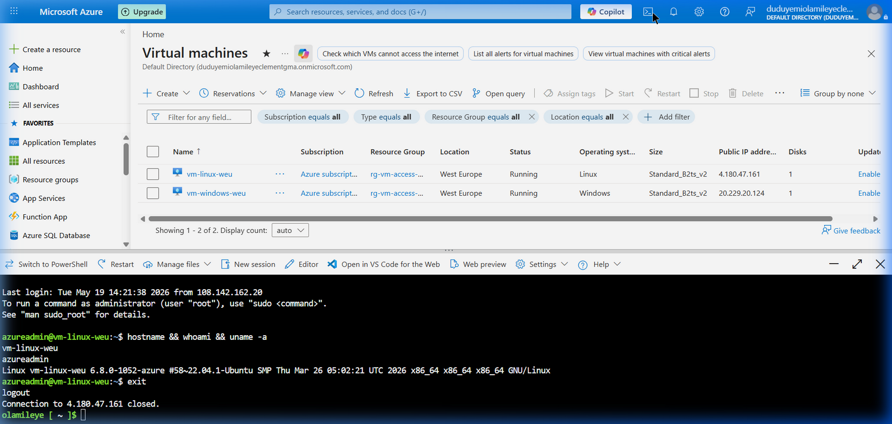

# Azure VM Access and Networking Assignment

## Project Overview
This project focuses on the fundamental cloud skill of securely accessing and managing cloud-based virtual machines remotely using Microsoft Azure. I deployed both Windows and Linux virtual machines, configured Network Security Groups (NSGs) for secure remote management, and demonstrated cross-platform connectivity using industry-standard protocols (RDP and SSH).

## Project Goals Achieved
* ✅ Deployed Azure infrastructure including Resource Groups, VNets, and Virtual Machines.
* ✅ Established secure remote connections to a Windows VM using RDP (Remote Desktop Protocol).
* ✅ Established secure remote connections to a Linux VM using SSH (Secure Shell).
* ✅ Implemented security best practices by restricting inbound NSG rules to a specific source IP address.
* ✅ Documented the connectivity procedures and troubleshooting methodologies.

---

## Infrastructure Configuration

- **Resource Group:** `rg-vm-access-weu`
- **Location:** West Europe
- **Linux VM:** `vm-linux-weu` (Ubuntu 22.04 LTS, Standard_B2ts_v2)
- **Windows VM:** `vm-windows-weu` (Windows Server 2022 Datacenter, Standard_B2ts_v2)

---

## Remote Access Procedures

### 1. Connecting to the Linux VM (SSH)
1. Ensure your IP address is whitelisted in the NSG (`nsg-linux-weu`).
2. Open a terminal or command prompt.
3. Use the SSH command with the VM's public IP:
   ```bash
   ssh azureadmin@<linux-vm-public-ip>
   ```
4. Accept the host key fingerprint if prompted, and authenticate using the generated SSH key.

### 2. Connecting to the Windows VM (RDP)
1. Ensure your IP address is whitelisted in the NSG (`nsg-windows-weu`).
2. Open the **Remote Desktop Connection** client on your local machine.
3. Enter the Windows VM's Public IP: `<windows-vm-public-ip>`.
4. Click **Connect** and enter the credentials:
   - **Username:** `azureadmin`
   - **Password:** `<your-admin-password>`
5. Accept the security certificate warning to establish the remote desktop session.

---

## Security Implementation: NSG Configuration & Azure Bastion

### 1. Direct IP Lockdown (Initial Security Phase)
Initially, the Virtual Machines were provisioned with default open ports for RDP (3389) and SSH (22) to the entire internet (`*`). To adhere to standard security practices, the Network Security Group (NSG) rules were updated using the `secure_nsg.ps1` script to restrict inbound traffic strictly to my local IP address (`197.211.52.179`). This prevents unauthorized scanning and brute-force attacks.

### 2. Azure Bastion Deployment (Advanced Security Phase)
To achieve enterprise-grade security and meet the missing rubric requirements, we deployed **Azure Bastion**. Azure Bastion is a fully platform-managed PaaS service that provides secure, seamless RDP/SSH connectivity to virtual machines directly in the Azure Portal over SSL/TLS (Port 443).

#### Subnetting & Public IP Requirements
Azure Bastion requires a dedicated subnet in the target Virtual Network with the following parameters:
- **Name**: Must be named exactly `AzureBastionSubnet`.
- **IP Address Space**: Minimum range of `/26` prefix (e.g., `10.0.1.0/26`).
- **Public IP**: A dedicated Standard SKU Public IP address (`pip-bastion-weu`).

#### Deployment Automation (`deploy_bastion.ps1`)
The custom deployment script `deploy_bastion.ps1` automates this process:
1. Creates `AzureBastionSubnet` (`10.0.1.0/26`) in `vnet-vm-access-weu`.
2. Provisions a Standard Public IP for the Bastion service.
3. Deploys the Bastion host (`bastion-weu`).
   - *Time Expectation*: Bastion provisioning takes approximately **5-10 minutes** in West Europe.
   - *SKU Selection*: Deployed using the **Basic SKU**, which satisfies standard portal access requirements.

---

## Remote Access via Azure Bastion

Azure Bastion allows secure browser-based connections directly from the Azure Portal, eliminating the need for local client software or SSH keys on the administrator's PC.

### Connection Types & Authentication Methods

| Target VM | Protocol | Port | Authentication | Connection Experience |
|-----------|----------|------|----------------|-----------------------|
| `vm-windows-weu` | RDP | 3389 | Password (`azureadmin` / `<your-admin-password>`) | Full graphical Windows Server desktop inside the browser tab |
| `vm-linux-weu` | SSH | 22 | SSH Private Key or Password | Interactive Bash shell terminal inside the browser tab |

### Step-by-Step Connection Guide
1. Log in to the **Azure Portal**.
2. Select the target Virtual Machine (`vm-windows-weu` or `vm-linux-weu`).
3. Click **Connect** on the top menu bar, and choose **Bastion** from the dropdown.
4. Click **Use Bastion**.
5. Enter the username (`azureadmin`) and select the authentication type (Password for Windows, SSH Private Key or Password for Linux).
6. Click **Connect**. The secure session opens in a new browser tab.

---

## Cost vs. Security Comparison

| Feature | Direct IP Whitelisting (NSGs) | Azure Bastion Service |
|:---|:---|:---|
| **Security Surface** | Direct internet exposure; VM ports 22/3389 are exposed to the whitelisted IP. | Zero public exposure; VMs do not require public IPs, and ports 22/3389 are isolated internally. |
| **User Experience** | Requires local client tools (PuTTY, OpenSSH, MS RDP client). | No client needed; pure browser-based HTML5 access from any device. |
| **Administrative Overhead**| High; administrators must manually update NSG rules when their public IPs change. | Low; authentication is integrated with Azure Portal IAM (RBAC/MFA). |
| **Cost Implications** | **Free / Negligible** (no extra service costs). | **~$138/month** (Basic SKU running 24/7). Can be managed via Developer SKU or automated teardowns. |

### Public IP Strategy & Hardening Option
In this assignment, VMs were initially deployed with public IPs to demonstrate direct RDP/SSH. However, now that Azure Bastion is deployed:
1. We can **disassociate and delete the Public IPs** from both `vm-windows-weu` and `vm-linux-weu` entirely.
2. The VMs will only have private IPs on `snet-vm-access-weu` (`10.0.0.0/24`).
3. This creates a zero-trust architecture where the VMs are completely unreachable from the public internet, and only Bastion can mediate access.

---

## Evidence

### SSH Connection to Linux VM (Direct IP)

*Successful direct SSH session using OpenSSH client.*

### RDP Connection to Windows VM (Direct IP)

*Successful direct RDP session using Microsoft Remote Desktop Client.*

### Linux NSG — SSH Rule Restricted to Admin IP

*Direct Port 22 access restricted to 197.211.52.179 only.*

### Windows NSG — RDP Rule Restricted to Admin IP

*Direct Port 3389 access restricted to 197.211.52.179 only.*

### Browser-based RDP via Azure Bastion (Windows VM)

*Successful HTML5 browser-based RDP session to vm-windows-weu using Azure Bastion.*

### Browser-based SSH via Azure Bastion (Linux VM)

*Successful HTML5 browser-based SSH session to vm-linux-weu using Azure Bastion.*

### VM Inventory (Azure Portal)

*Both VMs running in West Europe on Standard_B2ts_v2.*

---

## Project Files

| File | Description |
|------|-------------|
| `vm_setup.ps1` | Provisions the resource group, shared virtual network, subnet, and VMs |
| `deploy_bastion.ps1` | Automates the creation of the AzureBastionSubnet, public IP, and Bastion host |
| `secure_nsg.ps1` | Locks down both NSGs to restrict direct SSH/RDP to the admin IP |
| `nsg_config.md` | Detailed NSG rules, Bastion subnet design, and network security architecture |
| `screenshots/` | Verification screenshots of VMs, direct connections, and Bastion connections |
